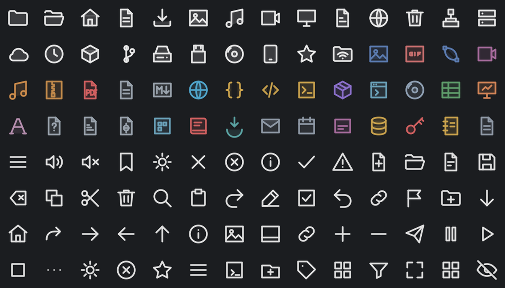

# NeoLine

**Fedora 44 and 45: there are ready-made packages on COPR**, no building needed:

```
sudo dnf copr enable morzilla/desktop-ng
sudo dnf install neoline-icons
```

Then pick NeoLine in System Settings > Icons. The same repository has the rest of the NG desktop: `breeze-ng`, `dolphin-ng`, `dialog-ng`, `neoline-icons` ([project page](https://copr.fedorainfracloud.org/coprs/morzilla/desktop-ng/)).



An outline icon theme for KDE Plasma: 24 px grid, 1.7 px round strokes. Action icons follow the colour scheme;
places and file types come in three variants:

- **NeoLine** – each kind in its own colour
- **NeoLine White** – places and devices in white, file types in colour
- **NeoLine Yellow** – places and devices in yellow, file types in colour

It also draws the best-known applications (browsers, terminal, editors, chat, media players, office, virtual
machines…) as one plain glyph each, in a colour that recalls the program; they keep that colour in every variant.

It has the **symbolic** icons too, the small monochrome ones that panels, bars and GTK applications ask for
(network and Wi-Fi with their signal levels, Bluetooth, volume, microphone, battery levels and charging,
brightness, notifications, window buttons, and a symbolic twin of every action and place): 336 of them, so the
theme also works outside Plasma, on niri, Sway, GNOME and the like.

Everything it does not draw is inherited from Breeze Dark, or from Adwaita where Breeze is not installed.

```
./make-icons.py            # writes the three themes here and installs them in ~/.local/share/icons
./make-icons.py --sheet    # also writes preview.html with every icon
./make-icons.py --symbolic # after changing a symbolic drawing in symbolic.py: turns the strokes into filled shapes (needs inkscape)
```

The installer of the NG desktop also sets the theme up, next to [Breeze NG](https://github.com/Morzilla/breeze-ng)
and [Dolphin NG](https://github.com/Morzilla/dolphin-ng), and lets you choose the variant:

```sh
bash <(curl -fsSL https://raw.githubusercontent.com/Morzilla/breeze-ng/ng/ng/install-gui.sh)
```


Then pick one in System Settings › Colours & Themes › Icons, or `/usr/libexec/plasma-changeicons NeoLine-White`.
To add an icon, put its path data in the `P` dictionary of the script and its name in `PLACES`, `MIMES` or
the actions list, and run the script again. Licence: MIT (see LICENSE). Drawn with Claude (Anthropic).

## Part of the NG desktop

- [Breeze NG](https://github.com/Morzilla/breeze-ng) – widget style and window decoration ([KDE Store](https://store.kde.org/p/2381557/))
- [Dolphin NG](https://github.com/Morzilla/dolphin-ng) – the file manager ([KDE Store](https://store.kde.org/p/2381561/))
- NeoLine on the KDE Store: https://store.kde.org/p/2381562/

The other variants: [colour](preview/neoline-1-colour.png), [yellow](preview/neoline-3-yellow.png).
